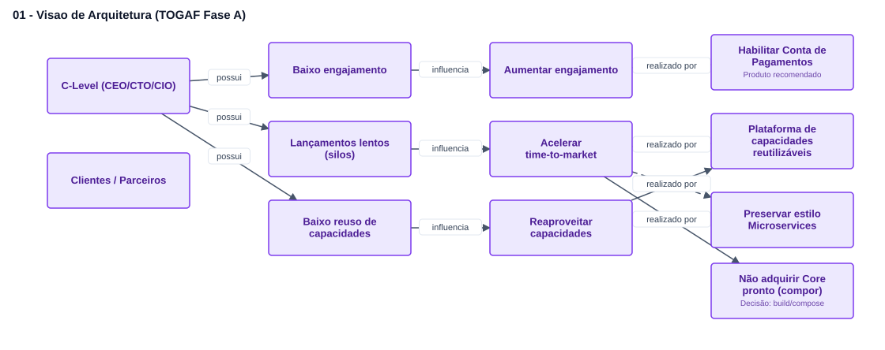
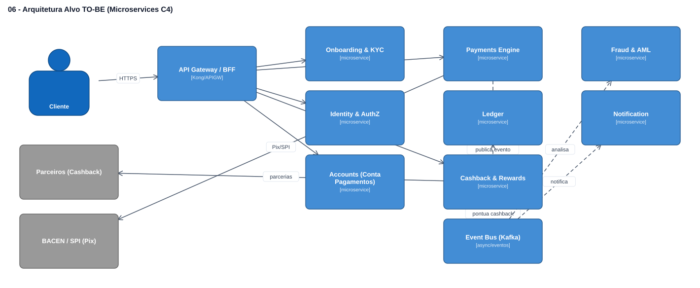
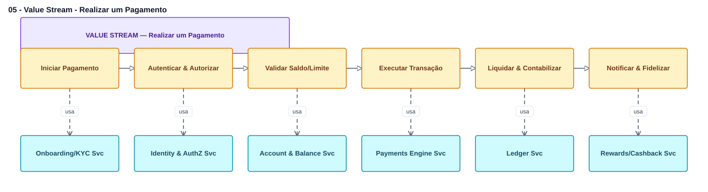

# 🏛️ Enterprise Architecture Studio

Aplicação web para **desenho de arquitetura corporativa** com suporte a **C4 Model**, **ArchiMate** e **TOGAF**. Pensada para apresentação a clientes: canvas limpo, notação padronizada e exportação em alta qualidade (PNG / SVG / PDF).


---

## ✨ Recursos

- **Canvas interativo em SVG** — arrastar e soltar, mover, conectar, zoom/pan, grade com snap de 8px.
- **C4 Model (completo)** — Pessoa, Sistema, Sistema Externo, Container, Database, Fila, Componente e Boundaries, com os 4 níveis: Contexto → Container → Componente → Código.
- **ArchiMate básico** — elementos core das camadas de Negócio, Aplicação, Tecnologia e Motivação, com as cores padrão do The Open Group.
- **TOGAF** — guia do ciclo ADM (Fases A–H + Preliminar e Gestão de Requisitos) e templates de artefatos prontos (Visão, Negócio, Aplicações, Tecnologia) modelados em ArchiMate.
- **Relações tipadas** — estilo de linha (sólida/tracejada/pontilhada), pontas (seta, aberta, triângulo, losango) e rótulos.
- **Inspector de propriedades** — edição de rótulo, tecnologia, descrição, cores e dimensões.
- **Carimbo de identificação** — projeto, autor, papel e data, ativável sobre o canvas.
- **Persistência local** — biblioteca de diagramas no `localStorage` + import/export JSON.
- **Exportação** — PNG (2x), SVG e PDF (A4, ajuste automático).
- **Tema claro / escuro / automático** — três modos explícitos no menu de tema; o modo **Automático** segue a preferência do sistema operacional em tempo real e a escolha é persistida.
- **Atalhos** — `Ctrl+Z`/`Ctrl+Y` (desfazer/refazer), `Ctrl+S` (salvar), `Delete` (excluir seleção).

## 🧱 Stack

React 19 · TypeScript · Vite 6 · Tailwind CSS 4 · lucide-react · html-to-image · jsPDF

## 🚀 Como rodar

Pré-requisitos: **Node.js 18+** e **npm**.

```bash
npm install
npm run dev      # http://localhost:5173
```

Outros scripts:

```bash
npm run build    # type-check + build de produção em dist/
npm run preview  # pré-visualiza o build
npm run lint     # verificação de tipos (tsc --noEmit)
```

## 📁 Estrutura

```
enterprise-architecture-studio/
├── case-arquiteto-banco/   # Estudo de caso resolvido (ver abaixo)
├── scripts/                # Geradores utilitários (Node ESM)
├── src/
│   ├── components/         # Navbar, Palette, Canvas, Inspector, NodeShape, EdgeShape, LibraryModal, Icon
│   ├── data/               # c4.ts, archimate.ts, togaf.ts, index.ts (catálogos e templates)
│   ├── hooks/              # useDiagram.ts (estado, histórico undo/redo)
│   ├── utils/              # storage.ts, export.ts, id.ts
│   ├── types.ts            # tipos de domínio (Diagram, EaNode, EaEdge, ElementDef...)
│   ├── App.tsx             # composição, atalhos, tema, export
│   └── main.tsx            # entrada React
├── index.html
├── vite.config.ts
└── tsconfig.json
```

## 🗺️ Como usar

1. Escolha o framework no topo da paleta (C4, ArchiMate ou TOGAF).
2. **C4:** selecione o nível (Contexto/Container/Componente/Código) e arraste elementos para o canvas.
3. **ArchiMate:** arraste elementos das 4 camadas; as cores seguem o padrão.
4. **TOGAF:** consulte o ciclo ADM e carregue um template de artefato como ponto de partida.
5. Conecte elementos clicando no nó (para selecioná-lo) e arrastando a alça azul à direita até outro nó.
6. Ajuste rótulos, cores e relações no painel direito.
7. Exporte em PNG/SVG/PDF ou salve na biblioteca.

## 🏦 Estudo de caso — Enterprise Architect (banco)

A pasta [`case-arquiteto-banco/`](./case-arquiteto-banco) contém um case completo de Enterprise Architecture resolvido **dentro desta ferramenta**: uma Visão de Arquitetura (TOGAF Fase A) para um banco que precisa aumentar engajamento e acelerar lançamentos, decidindo entre os produtos *Conta de Pagamentos* e *Cashback*.

- Documento executivo: [`00-VISAO-DE-ARQUITETURA.md`](./case-arquiteto-banco/00-VISAO-DE-ARQUITETURA.md)
- 7 diagramas `.eas.json` prontos para importar no app (Subdomínios DDD, Mapa de Capacidades, Value Chain, Value Stream, Arquitetura Alvo em Microservices, Roadmap de Migração).

Para abrir: `npm run dev` → barra superior → **Importar** → selecione cada `*.eas.json`.

Prints das arquiteturas (em `case-arquiteto-banco/images/`):

| Visão (TOGAF Fase A) | Arquitetura Alvo (Microservices · C4) |
|---|---|
|  |  |

| Subdomínios (DDD) | Value Stream |
|---|---|
|  |  |

Os diagramas são regeneráveis com:

```bash
node scripts/generate-case.mjs
```

## 🧭 Notas de escopo

- **TOGAF é um método, não uma notação.** Por isso o suporte é feito via guia do ADM + templates em ArchiMate (linguagem de modelagem recomendada pelo The Open Group).
- **ArchiMate** aqui cobre um subconjunto prático (elementos core). Relacionamentos específicos do ArchiMate (realização, serving, acesso etc.) são representados por rótulo + estilo de linha configuráveis.

## 🤝 Contribuindo

Contribuições são bem-vindas. Veja [CONTRIBUTING.md](./CONTRIBUTING.md) para o fluxo de branches, padrão de commits e checagens antes do PR.

## 📄 Licença

Distribuído sob a licença **MIT**. Veja [LICENSE](./LICENSE).
